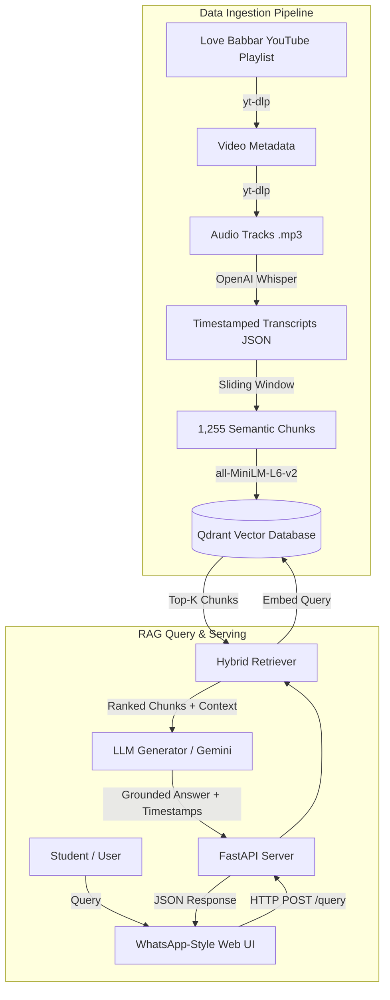

# 🚀 AskBabbar — Love Babbar C++ Placement DSA Course RAG Assistant

An end-to-end, production-grade **Retrieval-Augmented Generation (RAG)** assistant trained on **Love Babbar's Complete C++ Placement DSA Course** (all 149 lectures).

Ask any DSA or C++ question and receive answers strictly grounded in actual lecture content—complete with **clickable YouTube timestamp links** to watch the exact moment the topic is explained.


---

## ✨ Features

- **Full Playlist Coverage**: Indexes all **149 lectures** (from basics of C++, pointers, and recursion to trees, graphs, dynamic programming, heaps, and tries).
- **Exact YouTube Timestamp Linking**: Every cited source links directly to the specific second in the YouTube video (`https://youtube.com/watch?v=...&t=XXs`).
- **Hybrid Retrieval Engine**:
  - Dense semantic search using `sentence-transformers/all-MiniLM-L6-v2` (384 dimensions).
  - Title keyword matching and token overlap boosting.
  - Adjacent chunk expansion for full conversational context.
  - Domain guard rails to keep queries strictly on C++ & DSA topics.
- **Grounded Answer Synthesis**: Powered by Google Gemini (`gemini-1.5-flash` / `gemini-pro`) with fallback to extractive transcript cards if offline or rate-limited.
- **WhatsApp-Style Web UI**:
  - Clean, distraction-free WhatsApp Dark theme.
  - Bottom-docked input bar with auto-expanding textarea (`Enter` to send, `Shift+Enter` for newline).
  - Interactive source cards with lecture number, topic title, timestamp duration, and YouTube direct play buttons.
  - Filter drawer for custom top-k retrieval, similarity thresholds, and search-only mode.
- **100% Test Coverage**: Complete test suite with 34 unit and integration tests (`pytest`).

---

## 🏗️ System Architecture



---

## 📂 Project Structure

```text
love-babbar-rag/
├── backend/                  # FastAPI Application & RAG Core
│   ├── config.py             # Settings, paths, and environment configuration
│   ├── main.py               # FastAPI router and lifespan manager
│   ├── llm/
│   │   └── generator.py      # Gemini response generator with retry & fallback
│   ├── models/
│   │   └── schemas.py        # Pydantic schemas (QueryRequest, QueryResponse, etc.)
│   ├── retrieval/
│   │   ├── embedder.py       # SentenceTransformers embedding model wrapper
│   │   ├── qdrant_store.py   # Qdrant client vector operations
│   │   └── retriever.py      # Hybrid search, scoring, and domain guards
│   └── utils/
│       └── logging.py        # Centralized structured logging
├── data/
│   ├── manifests/            # Playlist and video metadata (149 videos)
│   ├── transcripts/          # Whisper transcriptions with timestamp segments
│   ├── chunks/               # Chunked transcript segments with metadata
│   └── qdrant_db/            # Local persistent Qdrant vector storage
├── frontend/                 # WhatsApp-Style Web Interface
│   ├── index.html            # Main web layout and docked chat bar
│   ├── style.css             # Clean dark theme styling
│   └── app.js                # Chat logic, API communication, markdown rendering
├── scripts/                  # Data Ingestion Pipeline Scripts
│   ├── 01_fetch_metadata.py  # Step 1: Fetch playlist video manifest
│   ├── 02_download_audio.py  # Step 2: Download audio streams
│   ├── 03_transcribe.py      # Step 3: Transcribe with Whisper
│   ├── 04_chunk.py           # Step 4: Sliding window chunking
│   ├── 05_index_qdrant.py    # Step 5: Embed and index into Qdrant
│   └── run_pipeline.py       # Master end-to-end pipeline runner
├── tests/                    # Pytest test suite (34 tests)
├── .env.example              # Environment variables template
├── .gitignore                # Git ignore rules (protects audio, secrets, DB)
├── pytest.ini                # Pytest configuration
├── requirements.txt          # Python dependencies
├── run_server.py             # Server launcher script
└── README.md                 # Project documentation
```

---

## ⚡ Quick Start

### 1. Prerequisites
- Python 3.10+ installed
- Git installed
- (Optional) FFmpeg installed on system for audio processing

### 2. Clone Repository
```bash
git clone https://github.com/your-username/love-babbar-dsa-rag.git
cd love-babbar-dsa-rag
```

### 3. Create Virtual Environment
```bash
# Windows
python -m venv venv
.\venv\Scripts\activate

# Linux / macOS
python3 -m venv venv
source venv/bin/activate
```

### 4. Install Dependencies
```bash
pip install -r requirements.txt
```

### 5. Setup Environment Variables
Copy `.env.example` to `.env`:
```bash
# Windows PowerShell
cp .env.example .env

# Linux / macOS
cp .env.example .env
```
Open `.env` and add your **Google Gemini API Key**:
```env
GEMINI_API_KEY=your_gemini_api_key_here
```
*(Get a free key from [Google AI Studio](https://aistudio.google.com/)).*

---

## 🏃 Running the Application

### Start the Web Server
```bash
python run_server.py
```
Once started, open your browser and visit:
👉 **`http://127.0.0.1:8000`**

### API Endpoints
- `GET /` — Serves the frontend web interface.
- `GET /health` — Health check & indexed vector points count.
- `POST /query` — Complete RAG pipeline (retrieves sources + synthesizes grounded answer).
- `POST /search` — Fast retrieval-only endpoint (returns ranked sources and timestamps).
- `GET /docs` — Interactive OpenAPI / Swagger UI.

---

## 🧪 Running Tests

The project includes unit and integration tests covering the retriever, vector store, schemas, server endpoints, and LLM generator:

```bash
pytest
```
All 34 tests should pass:
```text
======================== 34 passed in 6.82s ========================
```

---

## 🔄 Running the Ingestion Pipeline (From Scratch)

If you wish to re-run the transcription or ingestion pipeline:

```bash
# Run complete end-to-end pipeline
python scripts/run_pipeline.py

# Or run individual steps:
python scripts/01_fetch_metadata.py    # Fetch YouTube video info
python scripts/02_download_audio.py     # Download 64kbps MP3s
python scripts/03_transcribe.py         # Whisper transcription
python scripts/04_chunk.py              # Chunking transcripts
python scripts/05_index_qdrant.py       # Embed and write into Qdrant
```

---

## 🛡️ License & Acknowledgements

- **Course Content**: All credit for the lecture explanations and videos belongs to **Love Babbar** ([CodeHelp / YouTube Channel](https://www.youtube.com/@CodeHelp-by-Babbar)).
- **Purpose**: This project is built for educational reference, placement preparation, and rapid topic revision.
